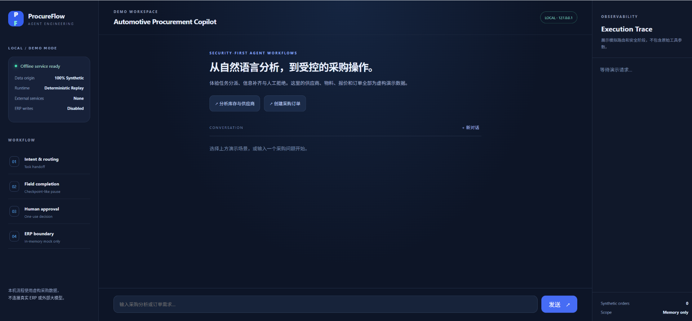
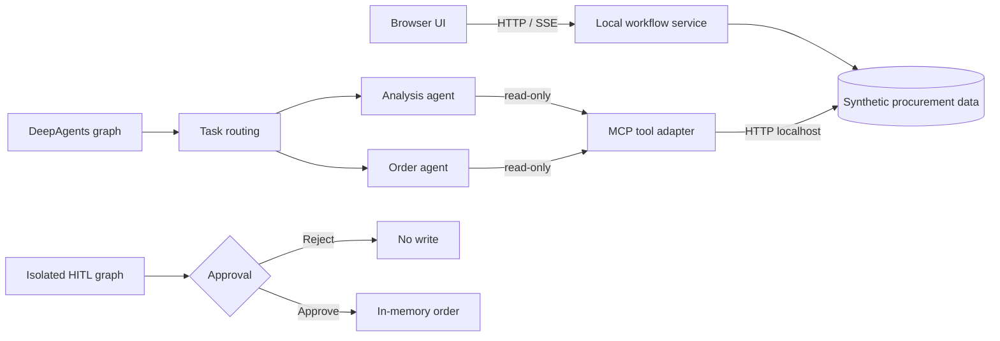

# ProcureFlow

**Automotive procurement workflow with agent routing, MCP tools, and human approval**

[简体中文](README.zh-CN.md) · [Architecture](docs/ARCHITECTURE.md) · [Setup](docs/OPERATIONS.md) · [Tests](docs/ACCEPTANCE.md)



ProcureFlow implements a procurement workflow for automotive parts: explore suppliers and inventory, collect missing purchase-order fields, and require an explicit human decision before creating an order. It includes a browser application, an MCP ERP adapter, a DeepAgents integration runner, and isolated approval tests.

## Features

- **Supplier and inventory exploration** — read parts, suppliers, stock alerts, and order details through MCP tools.
- **Task routing** — route requests to procurement analysis or purchase-order agents, with guarded delegation targets.
- **Order field completion** — request missing part, quantity, price, supplier, or delivery-date information before approval.
- **Human approval** — interrupt a proposed write, support rejection, and protect accepted operations from authorization replay.
- **Constrained integrations** — only localhost mock data is accessible in the included runtime; sensitive ERP backends and credentials are not required.

## System architecture



The browser workflow, DeepAgents/MCP integration, and HITL write test are independent execution paths. The browser uses deterministic synthetic data, while the integration runners execute the actual DeepAgents/LangGraph and FastMCP frameworks with a deterministic test model. They do not use an online LLM or connect to a production ERP. See [architecture](docs/ARCHITECTURE.md) for component boundaries.

## Quick start

**Prerequisite:** Python 3.10 or newer. The local browser application uses only the Python standard library.

```bash
python -B -m demo.server --port 18881
```

Open **http://127.0.0.1:18881**. Select *Analyze inventory and suppliers* or *Create purchase order*. The latter requests missing information and reaches an approval decision. Order writes are disabled by default. An opt-in `--allow-in-memory-writes` mode writes fictional orders to process memory only.

To run the automated suite:

```bash
python -B -m unittest discover -s tests -v
python -B scripts/audit_release.py
```

## Integration tests

The MCP and agent checks use optional third-party dependencies and two localhost endpoints, with no external ERP connectivity. Follow the [integration setup guide](docs/OPERATIONS.md).

| Component | Test entry point | Verified behavior |
| --- | --- | --- |
| MCP tool adapter | `scripts/verify_mcp_read_only.py` | 8 tools registered; 6 read operations against synthetic API; no order mutation |
| Routing and capability boundaries | `scripts/verify_agent_mcp_boundary.py` | Valid delegation, read-only agent tool selection, invalid target rejected |
| DeepAgents delegation | `scripts/verify_deepagents_graph.py` | Two sub-agents execute via a real graph and call local MCP tools |
| LangGraph approval | `scripts/verify_deepagents_hitl.py` | Interrupt and resume; reject without writes; approve one synthetic write; block replay |

The integration checks have been exercised on Windows with the project environment; the default GitHub Actions job runs the standard-library unit tests, source scan, and JavaScript syntax check. See [test coverage and reproducibility](docs/ACCEPTANCE.md).

## Repository layout

```text
ProcureFlow/
├── demo/              # Local HTTP/SSE application and synthetic ERP endpoints
├── src/agent/         # Agent routing, MCP client and sub-agent loading
├── src/mcp_server/    # FastMCP adapter and ERP-shaped tool interfaces
├── scripts/           # Integration runners and source checks
├── tests/             # Automated regression tests
└── docs/              # Architecture, setup and verification
```

## Runtime scope

The included browser server is a local development demo, not an authenticated production deployment. It contains no production data, database, live model connection, or real ERP writes. Production integration would require separate configuration, authentication, persistent storage, and end-to-end validation.

Security and source provenance are documented in [SECURITY.md](SECURITY.md) and [docs/PROVENANCE.md](docs/PROVENANCE.md).
