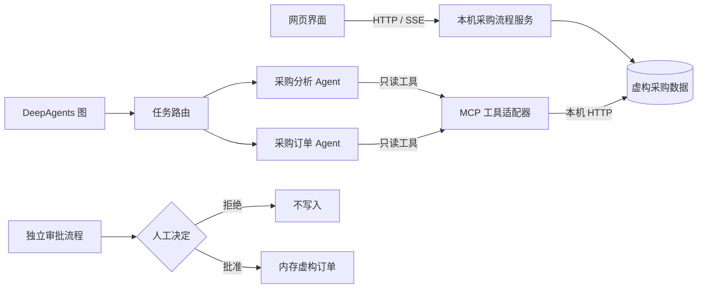

# ProcureFlow｜汽车零部件采购智能体系统

**采购分析、任务分派、MCP 工具调用与人工审批**

[English](README.md) · [系统架构](docs/ARCHITECTURE.md) · [部署与运行](docs/OPERATIONS.md) · [测试说明](docs/ACCEPTANCE.md)


ProcureFlow 面向汽车零部件采购场景，覆盖供应商与库存查询、采购订单信息补齐、Agent 任务路由和人工审批控制。仓库包含可直接运行的网页应用、MCP 工具适配器、DeepAgents 集成执行脚本及 LangGraph 审批测试。

## 核心功能

- **采购数据查询**：通过 MCP 工具查询供应商、物料、库存预警和订单明细。
- **多智能体任务分派**：区分采购分析和订单处理任务，并校验委派目标。
- **订单信息补齐**：物料、数量、价格、供应商或交货日期不完整时，要求补充后再继续。
- **人工审批**：写入前暂停，支持批准和拒绝；一次性授权防止重复执行或替换审批内容。
- **安全工具边界**：限定本机模拟 ERP 和只读能力，避免测试环境误连真实业务系统。

## 系统架构



网页流程、DeepAgents/MCP 集成和 HITL 写入测试是**三条独立的运行路径**。网页使用确定性虚构数据；集成脚本执行真实 DeepAgents、LangGraph、FastMCP 框架，但模型响应由本地确定性测试模型提供。当前不接入在线大模型或生产 ERP。详见 [架构文档](docs/ARCHITECTURE.md)。

## 快速启动

**运行环境：** Python 3.10+。网页应用只使用 Python 标准库，无需安装第三方依赖。

```bash
python -B -m demo.server --port 18881
```

在浏览器打开 **http://127.0.0.1:18881**，即可尝试库存与供应商分析、创建采购订单、信息补齐和人工拒绝流程。默认禁止写入；使用可选参数 `--allow-in-memory-writes` 时，也只会在当前 Python 进程内创建虚构订单。

运行自动化测试：

```bash
python -B -m unittest discover -s tests -v
python -B scripts/audit_release.py
```

## Agent 与 MCP 集成

运行集成脚本需要额外安装对应的 LangChain、DeepAgents、FastMCP 等依赖，并启动本机模拟服务。具体步骤见 [运行手册](docs/OPERATIONS.md)。

| 模块 | 实现位置 | 验证内容 |
| --- | --- | --- |
| MCP 工具适配器 | `scripts/verify_mcp_read_only.py` | 发现 8 个工具，执行 6 项只读操作，不更改订单 |
| Agent 路由 | `scripts/verify_agent_mcp_boundary.py` | 委派校验、工具权限隔离、非法目标拒绝 |
| DeepAgents | `scripts/verify_deepagents_graph.py` | 实际运行图与两个子 Agent，并读取本机 MCP 数据 |
| LangGraph HITL | `scripts/verify_deepagents_hitl.py` | 中断恢复、拒绝零写入、批准一次虚构写入及防重放 |

以上集成验证已在 Windows 环境运行；GitHub Actions 默认执行无第三方依赖的单元测试、源码扫描和 JavaScript 语法检查。参见 [测试与验证](docs/ACCEPTANCE.md)。

## 项目目录

```text
ProcureFlow/
├── demo/              # 本机 HTTP/SSE 交互应用及虚构 ERP 数据
├── src/agent/         # Agent 路由、MCP 客户端、子 Agent 加载
├── src/mcp_server/    # FastMCP 工具适配器与 ERP 接口形状
├── scripts/           # 集成测试与源码检查脚本
├── tests/             # 自动化回归测试
└── docs/              # 架构、运行与测试文档
```

## 使用范围

当前浏览器服务用于本机开发与验证，不包含用户身份认证、真实数据库、在线模型推理或生产 ERP 写单。生产环境接入需要独立完成鉴权、持久化、运行配置及端到端验收。

安全说明见 [SECURITY.md](SECURITY.md)，源码来源与第三方归属见 [docs/PROVENANCE.md](docs/PROVENANCE.md)。
