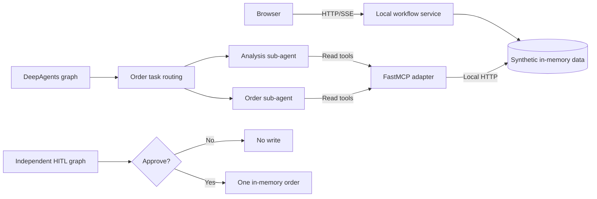

# Architecture

ProcureFlow contains a runnable procurement UI and separately executable integration paths for agent delegation and approval. They share workflow concepts but are not presented as a single deployed production graph.

## Browser application

`demo/server.py` exposes a loopback HTTP/SSE endpoint and static assets; `demo/engine.py` maintains fictional parts, suppliers, purchase-order state and approval tickets. The workflow requests missing fields and pauses for a human decision. The browser does **not** invoke DeepAgents directly. All state is in-memory and disappears on restart.

Host, Origin and JSON content-type checks are applied for local browser usage. There are no accounts, permissions per user, database or public-network hardening. Run the server on loopback only.

## Agent routing

`src/agent/middlewares/order_task_routing.py` and `src/agent/subagents/loader.py` implement guarded task routing and sub-agent configuration loading. `src/agent/tools/mcp_client.py` restricts the MCP target and groups tool access. `scripts/verify_agent_mcp_boundary.py` verifies invalid delegations fail closed and that read-only sub-agents cannot call write operations.

## MCP ERP adapter

`src/mcp_server/` contains FastMCP tool registrations for supplier, part, inventory and order operations. Eight tools can be discovered; integration runners invoke only the six read-only tools. `server_config.py` pins the adapter to the synthetic ERP endpoint `http://127.0.0.1:18881/api`; the adapter normally listens on `127.0.0.1:18880`. Discovery of order-write tool names does not grant those operations to test agents.

## DeepAgents execution

`scripts/verify_deepagents_graph.py` uses actual `create_deep_agent` graph execution and a deterministic `BaseChatModel` in place of a live LLM. It delegates to the procurement analyst and procurement order sub-agents, invokes read-only MCP tools and checks that orders remain unchanged. It exercises orchestration and integration, not model-quality metrics.

## Human-in-the-loop

`scripts/verify_deepagents_hitl.py` creates a separate DeepAgents/LangGraph process with checkpointed interrupts and `Command(resume=...)`. A one-use, operation-and-arguments-bound grant permits a single synthetic in-memory order after approval. A rejected action, missing grant, changed arguments or reused grant cannot write. The HITL test is not connected to the MCP write endpoints or any Java ERP.

## Source boundaries

Original ERP implementation excerpts are excluded from the current source tree. This repository does not include production credentials, an authenticated multi-user API, or the full Java ERP backend.
